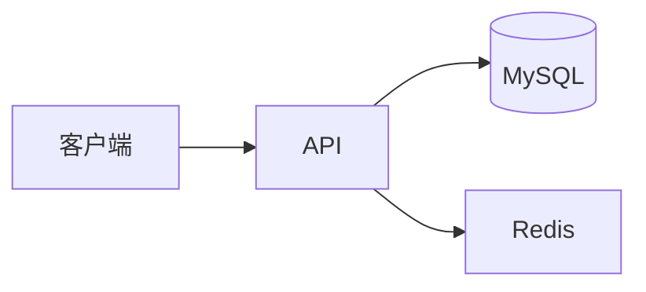

# Mermaid 结构图

文档：[mermaid.js.org](https://mermaid.js.org/) · 本仓库常见：`docs/**/*.md`、课程 HTML 内嵌。

## 何时用

- 表达 **步骤、分支、系统边界**；比 AI 生成的「神秘仪表盘 PNG」更可维护。

## 语法要点



- `flowchart` 优先于旧 `graph`。
- 节点文案 **中文 + 英文实体名** 二选一，勿过长。
- _sequence_ 用于请求链路；_stateDiagram_ 用于订单/状态机。

## 在 Markdown 中

````markdown
```mermaid
flowchart TB
  start --> end
```
````

## 在静态 HTML 课程中

可引 CDN `mermaid.min.js` + `mermaid.initialize({ startOnLoad: true, theme: 'neutral' })`；主题用 `neutral`/`base` 避免默认过艳。

## 禁止

- 一图超过 15 节点不拆分。
- 用 Mermaid 画 **像素级 UI mock**（应使用 shadcn 或手绘 skill）。
